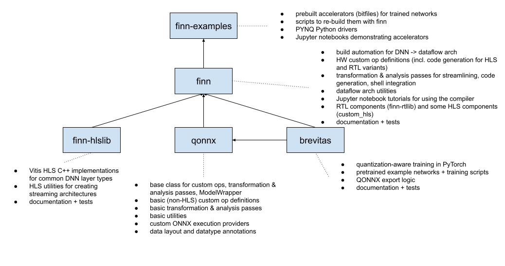

***********************
Developer documentation
***********************

This page is intended to serve as a starting point for new FINN developers.
Power users may also find this information useful.

Prerequisites
================

Before starting to do development on FINN it is a good idea to start
with understanding the basics as a user. Going through all of the
:ref:`tutorials` is strongly recommended if you haven't already done so.
Additionally, please review the :ref:`concepts` documentation and the :doc:`/implementation/index`.

Repository structure
=====================

The figure above gives a description of the repositories used by the
FINN project, and how they are interrelated.

Branching model
===============

All of the FINN repositories mentioned above use a variant of the
GitHub flow from https://guides.github.com/introduction/flow as
further detailed below:

* The `master` or `main` branch contains the latest released
  version, with a version tag.

* The `dev` branch is where new feature branches get merged after
  testing. `dev` is "almost ready to release" at any time, and is
  tested with nightly Jenkins builds -- including all unit tests
  and end-to-end tests.

* New features or fixes are developed in branches that split from
  `dev` and are named similar to `feature/name_of_feature`.
  Single-commit fixes may be made without feature branches.

* New features must come with unit tests and docstrings. If
  applicable, it must also be tested as part of an end-to-end flow,
  preferably with a new standalone test. Make sure the existing
  test suite (including end-to-end tests) still pass.
  When in doubt, consult with the FINN maintainers.

* When a new feature is ready, a pull request (PR) can be opened
  targeting the `dev` branch, with a brief description of what the
  PR changes or introduces.

* Larger features must be broken down into several, smaller PRs. If
  your PRs have dependencies on each other please state in which order
  they should be reviewed and merged.

Docker images
===============

``pyproject.toml`` declares Python dependencies and groups; ``uv.lock`` records
exact versions and Git selections. Use uv 0.10.0 for updates and commit both
files. All groups resolve together. Run ``uv sync --locked`` for development.

``docker/build`` uses Bake to prepare staged system, Python, runtime and
board-resource layers. Development tags hash environment inputs rather than
ordinary FINN source files. Ubuntu 24.04 and Python 3.12 remain the tested base.
``docker/run`` mounts the checkout, installs FINN editable without dependencies,
and runs the requested argument vector. Failed preparation stops the command.

Configured host tools and licences are mounted automatically; ``--fpga`` makes
them a requirement and ``--no-tools`` leaves them out. Host discovery is the
standard-library ``docker/launcher.py`` (Python 3.10 or later); native activation
and containers share ``docker/finn-toolchain.sh``. ``--runtime xrt`` selects
accelerator userspace independently of host tools. Runtime manifests also
support supplied SLASH packages. Board kernel drivers remain host responsibilities.

External source trees live in verified resource caches, declared in
``src/finn/resources.toml``. Use ``finn-resources update NAME --ref REF`` to
change a pin and its digest; use ``FINN_RESOURCES_<NAME>`` for local development.
Persistent, content-keyed state (resources, XSI builds, golden references) lives
in ``FINN_HOME`` (default ``~/.finn``); build output lives in the disposable
``FINN_BUILD_DIR`` (default ``/tmp/finn_build_<uid>``). See ``docker/README.md``
and ``ci/README.md`` for the full variable list, migration and validation contracts.

(Re-)launching builds outside of Docker
========================================

It is possible to launch builds for FINN-generated HLS IP and stitched-IP folders outside of the Docker container.
This may be necessary for visual inspection of the generated designs inside the Vivado GUI, if you run into licensing
issues during synthesis, or other environmental problems.
Simply set the ``FINN_ROOT`` environment variable to the location where the FINN compiler is installed on the host
computer, and you should be able to launch the various .tcl scripts or .xpr project files without using the FINN
Docker container as well.

Linting
=======

We use a pre-commit hook to auto-format Python code and check for issues.
See https://pre-commit.com/ for installation. Once you have pre-commit, you can install
the hooks into your local clone of the FINN repo.
It is recommended to do this **on the host** and not inside the Docker container:

::

  pre-commit install

Every time you commit some code, the pre-commit hooks will first run, performing various
checks and fixes. In some cases pre-commit won't be able to fix the issues and
you may have to fix it manually, then run `git commit` once again.
The checks are configured in .pre-commit-config.yaml under the repo root.

Coding Standards
================

FINN follows specific coding conventions for Python, HLS/C++, and SystemVerilog code.
Please refer to the style guides in the repository root for detailed guidelines:

* `PYTHON_STYLE_GUIDE.md <https://github.com/Xilinx/finn/blob/dev/PYTHON_STYLE_GUIDE.md>`_

  - Python naming conventions, docstrings, type hints, and error handling
  - FINN-specific patterns: CustomOps, transformations, node attributes, testing

* `HDL_STYLE_GUIDE.md <https://github.com/Xilinx/finn/blob/dev/HDL_STYLE_GUIDE.md>`_

  - HLS/C++ template parameters, function naming, and pragma usage
  - SystemVerilog module structure, signal naming, and design patterns

Following these standards ensures consistency across the codebase and makes code
easier to read, review, and maintain.

Testing
========

Tests are vital to keep FINN running.  All the FINN tests can be found at https://github.com/Xilinx/finn/tree/main/tests.
These tests can be roughly grouped into three categories:

 * Unit tests: targeting unit functionality, e.g. a single transformation. Example: https://github.com/Xilinx/finn/blob/main/tests/transformation/streamline/test_sign_to_thres.py tests the expected behavior of the `ConvertSignToThres` transformation pass.

 * Small-scale integration tests: targeting a group of related classes or functions that to test how they behave together. Example: https://github.com/Xilinx/finn/blob/main/tests/fpgadataflow/test_convert_to_hls_conv_layer.py sets up variants of ONNX Conv nodes that are first lowered and then converted to FINN HLS layers.

 * End-to-end tests: testing a typical 'end-to-end' compilation flow in FINN, where one end is a trained QNN and the other end is a hardware implementation. These tests can be quite large and are typically broken into several steps that depend on prior ones. Examples: https://github.com/Xilinx/finn/tree/main/tests/end2end

Additionally, qonnx, brevitas and finn-hlslib also include their own test suites.
The full FINN compiler test suite
(which will take several hours to run) can be executed
by:

::

  ./docker/run --fpga -- python -m pytest

There is a quicker variant of the test suite that skips the tests marked as
requiring Vivado or as slow-running tests:

::

  ./docker/run -- bash docker/quicktest.sh

When developing a new feature it is useful to be able to run just a single test,
or a group of tests that e.g. share the same prefix.
You can do this inside the Docker container
from the FINN root directory as follows:

::

  pytest -k test_brevitas_debug --pdb

If you want to run tests in parallel (e.g. to take advantage of a multi-core CPU)
you can use:

* pytest-parallel for any rtlsim tests, e.g. `pytest -k rtlsim --workers auto`
* pytest-xdist for anything else, using `--dist=loadgroup`. e.g. `pytest -k mytest -n auto --dist=loadgroup`. Tests that exchange checkpoints must share an `xdist_group` marker so they stay on one worker.

Finally, the full test suite with appropriate parallelization can be run inside the container by:

::

  bash docker/quicktest.sh full

See more options on pytest at https://docs.pytest.org/en/stable/usage.html.

Documentation
==============

FINN provides two types of documentation:

* manually written documentation, like this page
* autogenerated API docs from Sphinx

Everything is built using Sphinx.

The documentation is built online by readthedocs:

  * finn.readthedocs.io contains the docs from the master branch
  * finn-dev.readthedocs.io contains the docs from the dev branch

When adding new features, please add docstrings to new functions and classes
(at least the top-level ones intended to be called by power users or other devs).
We recommend reading the Google Python guide on docstrings here for contributors:
https://google.github.io/styleguide/pyguide.html#38-comments-and-docstrings
